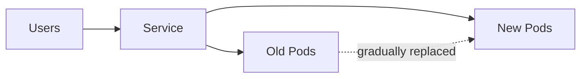
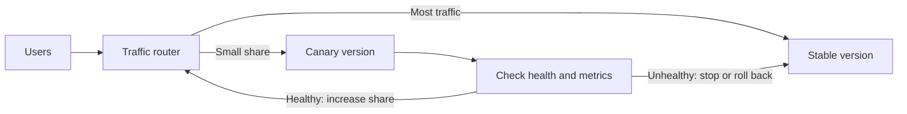
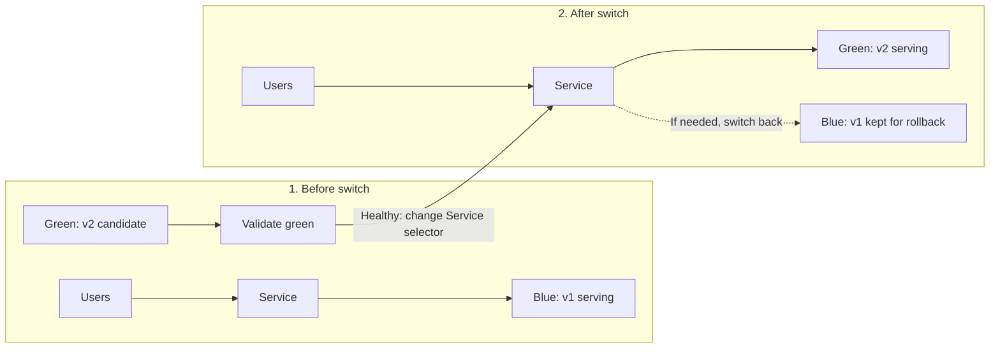

# Kubernetes Deployment Strategies

Deployment strategies describe how a new application version is introduced to users.

## Rolling Update

Gradually replaces old Pods with new Pods. Old and new versions may run at the same time.

- **Advantages:** Usually avoids downtime; no full duplicate environment is needed.
- **Trade-offs:** Requires versions to coexist safely; rollout is not an instant switch.
- **Kubernetes:** The default Deployment strategy. `maxSurge` and `maxUnavailable` control the rollout pace.
- **Use when:** You want a straightforward release and the versions are compatible.

## Canary

Sends a small portion of production traffic to the new version, then increases it if health and metrics look good.

- **Advantages:** Limits user impact if the release has problems; validates against real traffic.
- **Trade-offs:** Needs traffic splitting and monitoring; rollout and rollback require more coordination.
- **Kubernetes:** Usually needs an ingress controller, service mesh, or progressive-delivery tool for traffic splitting.
- **Use when:** A change is risky and you want to validate it gradually.

## Blue-Green

Runs two environments: **blue** serves users while **green** hosts the candidate version. After validation, switch traffic to green; switch back to blue to roll back.

- **Advantages:** Fast traffic switch and rollback.
- **Trade-offs:** Needs extra capacity; switching back does not undo database changes or other side effects.
- **Kubernetes:** Commonly implemented with separate Deployments and a Service whose selector is switched between versions.
- **Use when:** A quick cutover and rollback are important, and extra capacity is available.

## Quick Comparison

| Strategy | Traffic change | Main trade-off |
| --- | --- | --- |
| Rolling update | Gradual replacement | Old and new versions overlap |
| Canary | Gradual traffic increase | Needs traffic splitting and monitoring |
| Blue-green | Switch between environments | Needs capacity for both environments |

## Safe Rollouts

- Use readiness probes so traffic goes only to ready Pods.
- Monitor errors and latency; pause or roll back if they worsen.
- Keep APIs and database changes compatible with both versions during the rollout.